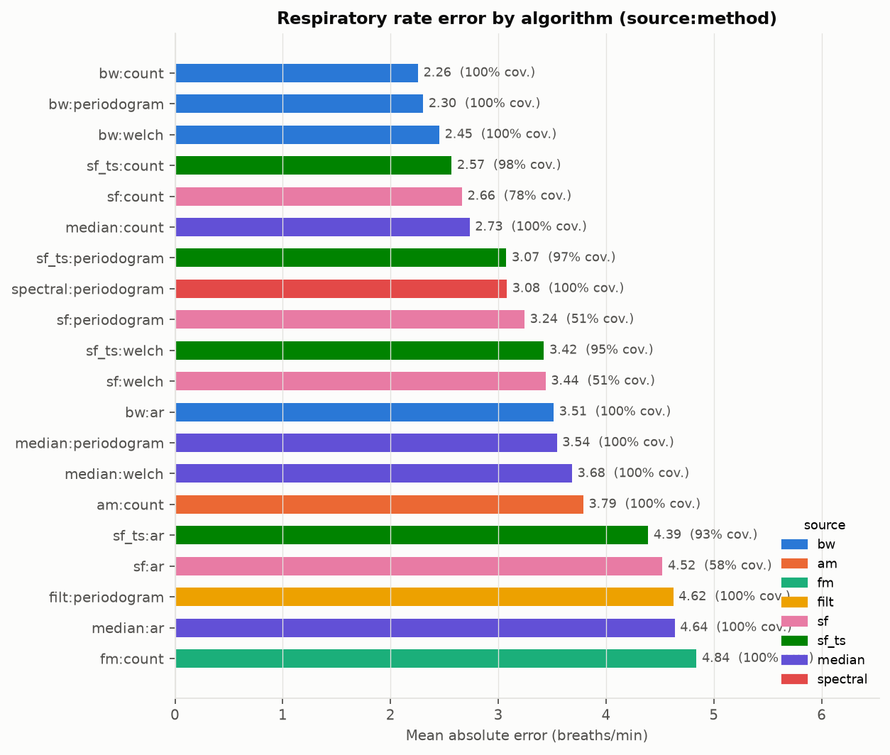
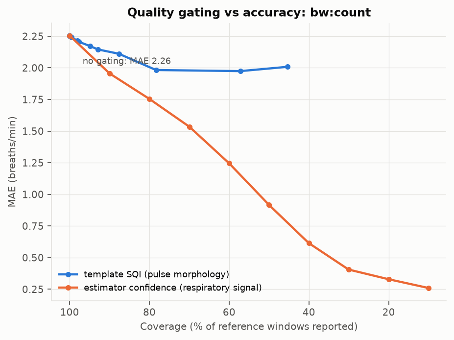
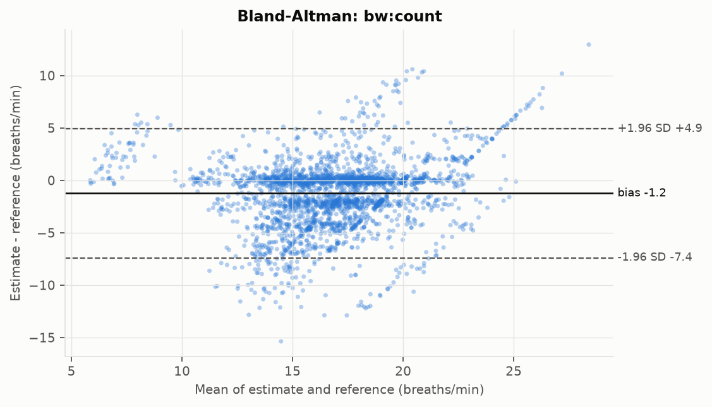

# Respira

[](https://github.com/27jackson08/Respira/actions/workflows/ci.yml)

**Respira** estimates respiratory rate (RR) from the photoplethysmogram (PPG),
the optical signal a pulse oximeter already records, and tests how well that
works on critically ill patients using the public
[BIDMC PPG and Respiration Dataset](https://physionet.org/content/bidmc/1.0.0/)
(53 eight-minute ICU recordings with manually annotated breaths).

Breathing leaves three faint fingerprints on the pulse waveform: the baseline
drifts (BW), the pulse amplitude swells and shrinks (AM), and the heart rate
speeds up and slows down (FM). Respira extracts all three with classical
digital signal processing, estimates RR from each with five different
estimators, fuses them, and scores every variant against the annotated
breaths. The question it answers: **can RR be read reliably from an existing
optical signal without a dedicated respiratory sensor?**

## Headline results

Default configuration: 32 s windows every 8 s, respiratory band 4-60
breaths/min, 53 subjects, 3021 windows of which 2809 have a reference the two
annotators agree on. Errors in breaths per minute (bpm). Full tables in
[`results/summary.md`](results/summary.md).

| Algorithm (`source:method`) | MAE | Median AE | Bias | 95 % LoA | CP2 | Coverage |
| --- | --- | --- | --- | --- | --- | --- |
| `bw:count` (baseline wander, breath counting) | **2.26** | 1.71 | -1.24 | -7.4 to 4.9 | 56 % | 100 % |
| `bw:periodogram` (baseline wander, spectral peak) | 2.30 | **0.46** | -1.75 | -9.8 to 6.3 | **75 %** | 100 % |
| `sf_ts:count` (Smart Fusion + temporal smoothing) | 2.57 | 2.12 | -0.91 | -7.0 to 5.2 | 48 % | 98 % |
| `sf:count` (Smart Fusion of BW/AM/FM) | 2.66 | 2.19 | -1.17 | -7.5 to 5.2 | 47 % | 78 % |
| `spectral:periodogram` (averaged BW/AM/FM spectra) | 3.08 | 0.52 | -2.03 | -12.0 to 8.0 | 69 % | 100 % |
| `filt:periodogram` (raw PPG band-passed, no beat detection) | 4.62 | 0.49 | 1.58 | -17.8 to 20.9 | 70 % | 100 % |
| `am:periodogram` (amplitude modulation only) | 5.84 | 5.08 | -3.67 | -17.3 to 10.0 | 38 % | 100 % |
| `fm:periodogram` (frequency modulation only) | 6.59 | 5.64 | -0.22 | -17.8 to 17.4 | 36 % | 100 % |
| *Bedside monitor impedance RR numeric (not PPG)* | *1.17* | *0.39* | *0.00* | *-5.8 to 5.8* | *88 %* | *100 %* |

CP2 is the fraction of estimates within 2 bpm of the reference. Coverage is
the fraction of reference windows for which the algorithm produced an
estimate.

For context, the group that published BIDMC reported a median MAE of 4.0 bpm
(IQR 1.8-5.5) on this dataset with 32 s windows (Pimentel et al. 2017), versus
1.5 bpm on healthy subjects. Respira's best single-source estimators reach a
mean MAE of 2.3 bpm and a median of 0.5-1.7 bpm at full coverage.



## What the evaluation shows

1. **Baseline wander carries almost all of the usable respiratory
   information in ICU PPG.** BW-based estimators score MAE 2.3 bpm; amplitude
   and frequency modulation alone score 5.8 and 6.6 bpm. Respiratory sinus
   arrhythmia (FM) is weak or absent in sedated, ventilated and arrhythmic
   patients, and AM is corrupted by vasoactive drugs and perfusion changes.

2. **Fusion does not help here.** Smart Fusion averages BW with the two poor
   modulations and discards disagreeing windows, so it loses coverage (78 %)
   without gaining accuracy. This is the opposite of what the healthy-subject
   literature reports and is a direct consequence of point 1.

3. **The dominant failure mode is sub-respiratory low-frequency content,
   not noise.** For `bw:periodogram`, 17 % of windows have errors below -5
   bpm and in those windows the estimate sits at about half the true rate: the
   spectral peak is captured by vasomotor (Mayer) waves and slow drift in the
   4-8 bpm range. Narrowing the band removes most of these errors:

   | Configuration | `bw:periodogram` | `bw:count` | `filt:periodogram` | `sf:count` |
   | --- | --- | --- | --- | --- |
   | 32 s, 4-60 bpm (default, Charlton et al. band) | 2.30 | 2.26 | 4.62 | 2.66 |
   | 32 s, 6-45 bpm | 1.89 | 1.96 | 2.28 | 2.28 |
   | 32 s, 8-40 bpm | 1.45 | 1.54 | 1.82 | 1.96 |
   | 64 s, 4-60 bpm | 2.00 | 2.13 | 3.78 | 2.64 |
   | 64 s, 8-40 bpm | **1.37** | 1.44 | 1.55 | 1.85 |

   The 4-60 band is kept as the default because the narrower bands cannot
   detect bradypnoea below 8 bpm, which is exactly the kind of event an ICU
   monitor must catch; the trade-off is reported rather than hidden. Full
   tables for each configuration are under `results/sensitivity/`.

4. **Pulse-morphology quality is the wrong quality measure for RR.** A
   template-matching PPG signal quality index (Orphanidou-style) is above 0.93
   in 90 % of windows and barely separates good from bad RR estimates: keeping
   only windows with SQI >= 0.96 lowers MAE from 2.26 to 1.98 bpm at 78 %
   coverage. Gating on the estimator's own confidence (breath-interval
   regularity for `count`, spectral peak purity for the periodogram) is far
   more effective: MAE 1.75 bpm at 80 % coverage, 0.92 bpm at 50 %, 0.41 bpm at
   30 %. A clean pulse does not imply a visible breath.

   

5. **Accuracy is patient-specific.** Per-subject MAE for `bw:count` ranges
   from 0.5 bpm (subject 20) to 7.1 bpm (subject 32) even though both have
   near-perfect pulse SQI. Compare `results/figures/subject_20_window_20.png`
   and `results/figures/subject_32_window_20.png`.

6. **The dedicated sensor still wins.** The bedside monitor's impedance RR,
   scored against the same manual annotations, has MAE 1.17 bpm and CP2 88 %.
   PPG-derived RR is good enough for trend monitoring and for flagging
   windows where it is confident, but not yet a drop-in replacement for an
   ICU respiratory channel.



## How it works

```text
PPG (125 Hz)
 ├─ band-pass 0.067-8 Hz ──────────────► amplitude measurement signal
 ├─ band-pass 0.5-8 Hz ─► peak/trough detection (prominence-gated, 40-180 bpm)
 │                          │
 │                          ├─ BW = (peak + trough) / 2      per beat
 │                          ├─ AM = peak - trough            per beat
 │                          └─ FM = peak-to-peak interval    per beat
 │                                     │ resample to 4 Hz, band-pass 4-60 breaths/min
 └─ band-pass 4-60 breaths/min ─► "filt" (no beat detection)
                                       │
                 32 s windows ─► periodogram | Welch | Burg AR | autocorrelation | breath counting
                                       │
                 fusion: Smart Fusion (SD <= 4 bpm) | median | averaged spectra | temporal smoothing
                                       │
                 reference: mean of two annotators' breath intervals, excluded if they differ > 2 bpm
                                       │
                 metrics: MAE, median AE, RMSE, bias, 95 % LoA, CP2, coverage; SQI and confidence sweeps
```

Design decisions, the literature behind them and the dataset quirks are
written up in [`docs/research.md`](docs/research.md).

## Install and reproduce

Requires Python 3.11+.

```bash
git clone https://github.com/27jackson08/Respira.git
cd Respira
python -m venv .venv && source .venv/bin/activate      # or: uv venv && source .venv/bin/activate
pip install -e ".[dev]"                                 # or: uv pip install -e ".[dev]"

respira demo                      # synthetic PPG with known RR, no data needed
respira download                  # ~200 MB of CSV from PhysioNet into data/raw/bidmc_csv/
respira run                       # estimate + evaluate all 53 subjects (~15 s), writes results/
respira inspect 32 --window-index 20   # four-panel figure for one window of one subject
```

Useful options: `--window 64 --step 8`, `--band 8 40`, `--subjects 01 07 53`,
`--out results/my_run`. `respira estimate` and `respira evaluate` run the two
halves separately; the evaluation re-reads `results/estimates.csv`.

Outputs of `respira run`:

| File | Content |
| --- | --- |
| `results/summary.md` | Markdown report: all algorithms, comparators, SQI and confidence sweeps, per-subject spread, configuration |
| `results/metrics_by_algorithm.csv` | One row per `source:method` |
| `results/metrics_by_algorithm_sqi_gated.csv` | Same, restricted to windows passing the SQI gate |
| `results/metrics_by_subject.csv`, `sqi_sweep.csv`, `confidence_sweep.csv`, `plausibility_gate.csv`, `comparators.csv` | Supporting tables |
| `results/figures/*.png` | Algorithm comparison, Bland-Altman, estimate vs reference, quality trade-off, per-subject MAE |
| `results/estimates.csv` | Every per-window estimate (about 110 000 rows; not committed) |

## Repository layout

```text
src/respira/
  config.py       frozen PipelineConfig with every tunable constant
  preprocess.py   zero-phase Butterworth filters, uniform resampling
  beats.py        PPG peak and trough detection
  riv.py          BW / AM / FM extraction and the direct-filter source
  estimators.py   periodogram, Welch, Burg AR, autocorrelation, Count-orig
  fusion.py       Smart Fusion, median, spectral averaging, temporal smoothing
  quality.py      template-matching SQI and beat plausibility checks
  reference.py    reference RR from breath annotations; monitor and impedance comparators
  pipeline.py     recording -> per-window estimate table
  evaluate.py     agreement metrics, SQI / confidence sweeps, per-subject tables
  plotting.py     figures
  report.py       summary.md
  synth.py        synthetic PPG generator with known RR (tests and demo)
  data/bidmc.py   PhysioNet downloader and CSV loader
  cli.py          `respira` command
tests/            113 pytest cases, 97 % line coverage, synthetic BIDMC fixtures
docs/research.md  background, literature, dataset notes, design rationale
results/          committed evaluation outputs for the default and sensitivity runs
```

## Testing

```bash
pytest --cov=respira          # unit + end-to-end tests on synthetic BIDMC-format data
ruff check src tests && ruff format --check src tests
```

The test-suite never touches the network: it writes synthetic recordings in
the exact BIDMC CSV layout (including ragged breath columns and the `-`
missing-value marker found in the real files) and runs the full CLI on them.

## Limitations and next steps

* Only 53 recordings from one ICU; results should not be read as general
  performance of PPG-derived RR.
* The reference is itself derived from thoracic impedance annotations; 7 % of
  windows were dropped because the two annotators disagreed.
* Band and window settings were explored on the same data they are reported
  on. Treat the sensitivity table as a description of the failure mode, not
  as tuned performance.
* Obvious extensions: adaptive band limits driven by the monitor heart rate,
  pole-magnitude selection across several AR orders (Pimentel et al. 2017),
  a learned confidence model, and evaluation on CapnoBase for a healthy-subject
  counterpart.

## References

* Pimentel M.A.F. et al. (2017). Toward a robust estimation of respiratory
  rate from pulse oximeters. *IEEE Trans Biomed Eng* 64(8):1914-1923.
* Charlton P.H. et al. (2016). An assessment of algorithms to estimate
  respiratory rate from the electrocardiogram and photoplethysmogram.
  *Physiol Meas* 37(4):610-626.
* Karlen W. et al. (2013). Multiparameter respiratory rate estimation from the
  photoplethysmogram. *IEEE Trans Biomed Eng* 60(7):1946-1953.
* Orphanidou C. et al. (2015). Signal-quality indices for the ECG and PPG.
  *IEEE J Biomed Health Inform* 19(3):832-838.
* Schäfer A., Kratky K.W. (2008). Estimation of breathing rate from
  respiratory sinus arrhythmia. *Ann Biomed Eng* 36(3):476-485.
* Goldberger A.L. et al. (2000). PhysioBank, PhysioToolkit, and PhysioNet.
  *Circulation* 101(23):e215-e220.

Dataset licence: Open Data Commons Attribution License v1.0. Code licence:
MIT.
